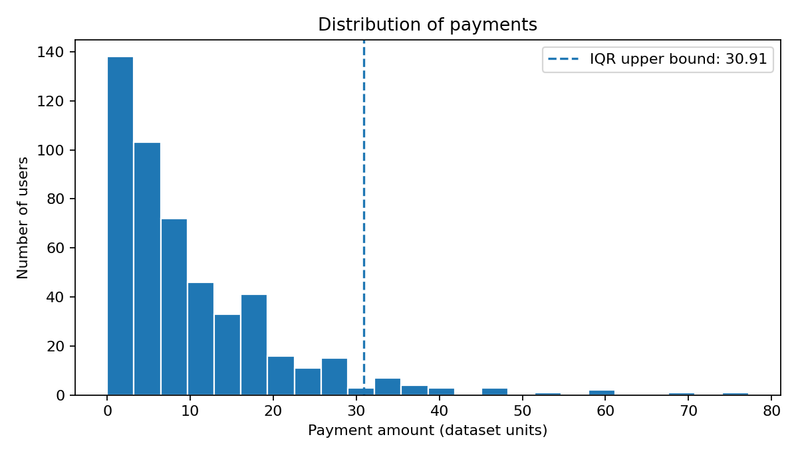
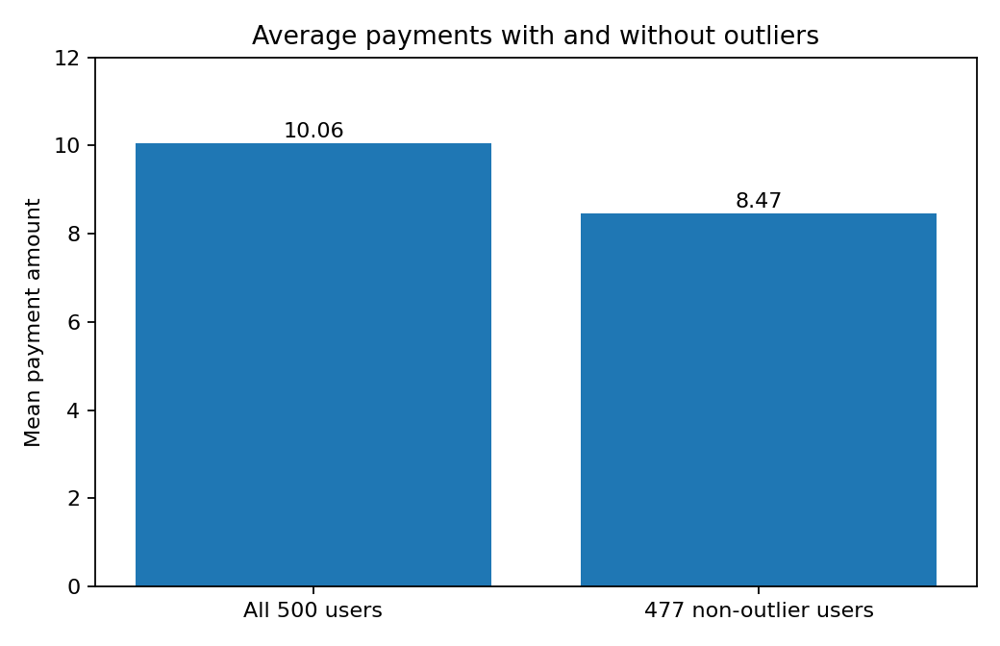
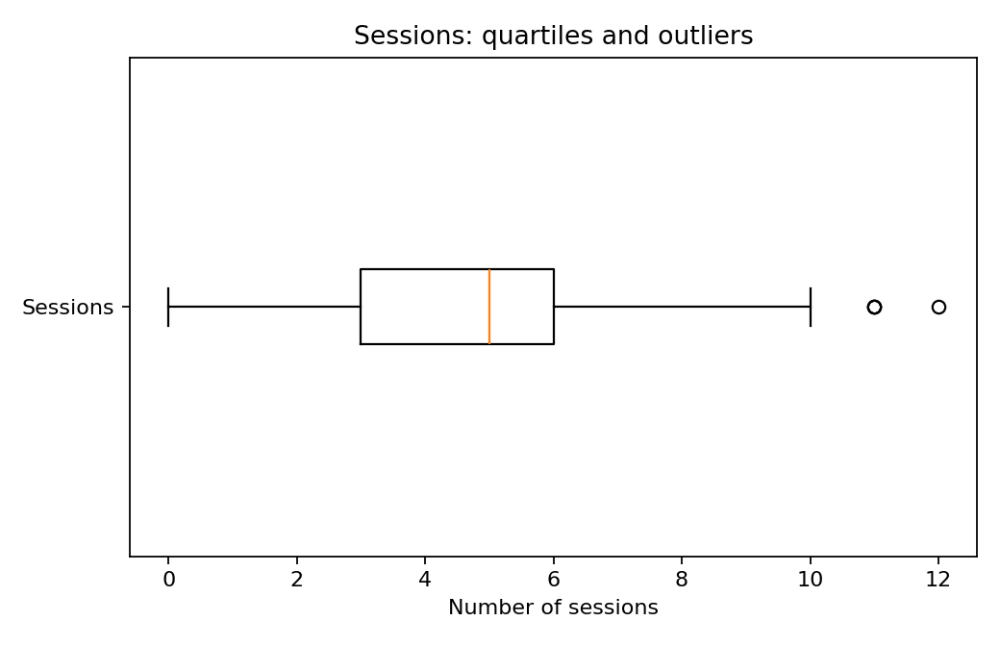

# Mobile Game User Behavior Analysis

A small data analysis project using a dataset of 500 mobile game users. I looked at sessions, payments, and time spent playing to understand typical behavior and identify unusual payments.

## Tools
- Google Sheets
- Excel
- Python (Pandas, Matplotlib)

## Analysis
I used descriptive statistics and the IQR method to identify outliers in user payments. I also created charts to explore the data distribution.

**Google Sheets workbook:** [View the completed course analysis](https://docs.google.com/spreadsheets/d/1v0bAnxpVylFp9zDvtibdfQbwZamMj1DZoMII2-TYiLM/edit?usp=sharing)

## Results

| Metric | Result |
|---|---:|
| Users | 500 |
| Average payment (all users) | 10.06 |
| Median payment | 6.71 |
| Payment Q1 / Q3 | 2.81 / 14.05 |
| Upper payment outlier boundary | 30.91 |
| High payment outliers | 23 |
| Low payment outliers | 0 |
| Average payment without outliers | 8.47 |
| Reduction in mean when outliers are excluded | 15.8% |
| Share of total payments contributed by high outliers | 19.7% |

The average payment is higher than the median, which suggests that larger values pull the mean upward. The 23 high-payment outliers account for about 19.7% of all payments in this dataset. Excluding them reduces the average from 10.06 to 8.47.

**Takeaway:** For describing what a typical user pays, the median can be more informative than the mean. However, high spenders still matter for revenue, so I would keep both measures in a business report rather than delete those users.

## Charts

### Payment distribution



### Average payments, with and without outliers



### Sessions distribution



## Files

- [`data/user_games.csv`](data/user_games.csv) — original course-provided dataset
- [`analysis/game_analysis.xlsx`](analysis/game_analysis.xlsx) — spreadsheet with data, outlier labels, and formula-based summary metrics
- [`analysis/analyze.py`](analysis/analyze.py) — reproducible Python script for metrics and charts
- [`charts/`](charts/) — exported visualizations

## Reproduce the analysis

You can inspect the spreadsheet without installing anything. To generate the charts using Python:

```bash
pip install -r requirements.txt
python analysis/analyze.py
```

## Notes

The outlier classification uses the rule `Q1 - 1.5 × IQR` and `Q3 + 1.5 × IQR`, with quartiles calculated using the inclusive method. An outlier is a flag for investigation, not proof that a transaction is erroneous. This is an educational dataset, so the findings should not be generalized to actual mobile game players.
